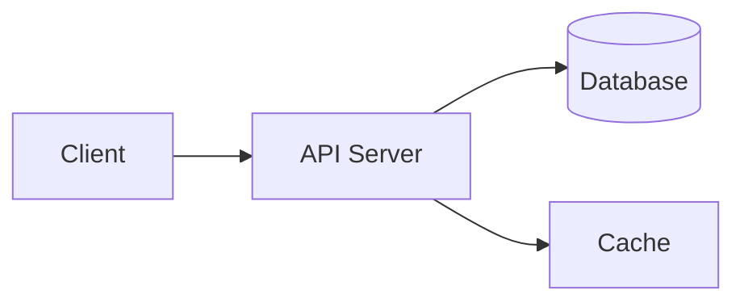

<div align="center">
  


Multi-device WhatsApp Bot based on Node.js, built with the Baileys library. Provides hundreds of commands through a modular plugin system — ranging from AI, sticker creation, group tools, to other utilities. Developed by Hai Ell Engineer.


[Demo](#) · [Dokumentasi](#) · [Laporkan Bug](#) · [Request Fitur](#)

</div>

---

## 📋 List

- [Tentang Proyek](#-tentang-proyek)
- [Fitur](#-fitur)
- [Demo / Screenshot](#-demo--screenshot)
- [Instalasi](#-instalasi)
- [Cara Pakai](#-cara-pakai)
- [Struktur Folder](#-struktur-folder)
- [Arsitektur / Diagram](#-arsitektur--diagram)
- [Konfigurasi](#-konfigurasi)
- [Teknologi yang Dipakai](#-teknologi-yang-dipakai)
- [Roadmap](#-roadmap)
- [Kontribusi](#-kontribusi)
- [FAQ](#-faq)
- [Lisensi](#-lisensi)
- [Kontak](#-kontak)
- [Ucapan Terima Kasih](#-ucapan-terima-kasih)

---

## 📖 About
MILENIA CHATBOT is a Node.js-based WhatsApp bot built using the Baileys library. Every command is designed to be concise—simply type it in and get an immediate result, without any complicated input formatting. Under the hood, the code structure is neat and consistent; a uniform pattern is applied across all plugins, ensuring that anyone who explores this project can quickly grasp the workflow and continue development without the headache of trying to decipher someone else’s code. Developed and maintained by Hai Ell Engineer, following the principle: *"From the original developers, for the next developers."*

> 💡 **Tips:** Kamu bisa pakai blockquote seperti ini untuk menonjolkan catatan penting.

## ✨ Fitur

- ✅ Fitur pertama yang keren
- ✅ Fitur kedua yang berguna
- ✅ Mendukung banyak platform
- 🚧 Fitur yang masih dalam pengembangan

## 🎬 Demo / Screenshot

<div align="center">
  
</div>

Atau video demo:

[](https://youtube.com/)

## ⚙️ Instalasi

Clone repository:

```bash
git clone https://github.com/username/nama-repo.git
cd nama-repo
```

Install dependency:

```bash
npm install
```

Jalankan proyek:

```bash
npm run dev
```

## 🚀 Cara Pakai

Contoh penggunaan dasar:

```js
import { contohFungsi } from "nama-paket";

const hasil = contohFungsi("halo dunia");
console.log(hasil);
```

<details>
<summary>📂 Klik untuk melihat contoh lanjutan (collapsible section)</summary>

```js
// Contoh konfigurasi lanjutan
const config = {
  mode: "production",
  debug: false,
};
```

Bagian ini otomatis bisa dilipat/dibuka oleh pembaca, cocok untuk konten panjang seperti changelog atau opsi lanjutan.

</details>

## 🗂️ Struktur Folder

```
nama-repo/
├── src/
│   ├── components/
│   ├── utils/
│   └── index.js
├── public/
├── tests/
├── package.json
└── README.md
```

## 🏗️ Arsitektur / Diagram

GitHub bisa merender diagram Mermaid langsung di README:



## 🔧 Konfigurasi

| Variabel       | Deskripsi                  | Default     |
|----------------|-----------------------------|-------------|
| `PORT`         | Port server                | `3000`      |
| `DATABASE_URL` | URL koneksi database       | -           |
| `DEBUG`        | Aktifkan mode debug        | `false`     |

## 🛠️ Teknologi yang Dipakai


## 🗺️ Roadmap

- [x] Rilis versi 1.0
- [x] Tambah dukungan multi-bahasa
- [ ] Integrasi dengan API pihak ketiga
- [ ] Mode offline

Lihat [open issues](https://github.com/username/repo/issues) untuk daftar lengkap fitur yang diusulkan.

## 🤝 Kontribusi

Kontribusi sangat diterima! Ikuti langkah berikut:

1. Fork proyek ini
2. Buat branch fitur (`git checkout -b fitur/FiturBaru`)
3. Commit perubahan (`git commit -m 'Menambahkan FiturBaru'`)
4. Push ke branch (`git push origin fitur/FiturBaru`)
5. Buka Pull Request

Baca [CONTRIBUTING.md](CONTRIBUTING.md) untuk panduan lebih lengkap.

## ❓ FAQ

<details>
<summary>Apakah proyek ini gratis digunakan?</summary>

Ya, proyek ini open source dan gratis digunakan sesuai lisensi yang tercantum.

</details>

<details>
<summary>Bagaimana cara melaporkan bug?</summary>

Buka tab [Issues](https://github.com/username/repo/issues) dan buat laporan baru dengan detail yang jelas.

</details>

## 📄 Lisensi

Didistribusikan di bawah Lisensi MIT. Lihat [`LICENSE`](LICENSE) untuk informasi lebih lanjut.

## 📬 Kontak

**Nama Kamu** - [@twitter_handle](https://twitter.com/handle) - email@contoh.com

Link Proyek: [https://github.com/username/repo](https://github.com/username/repo)

## 🙏 Ucapan Terima Kasih

- [Nama Library/Tools yang dipakai](https://github.com/)
- [Inspirasi desain README](https://github.com/)
- Semua kontributor yang sudah membantu 🎉

---

<div align="center">

⭐ Jangan lupa kasih **star** kalau proyek ini membantu!

</div>
