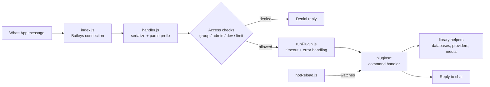

<div align="center">


# MILEINA CHATBOT

Multi-device WhatsApp bot built on Node.js and the Baileys library. It provides hundreds of commands through a modular plugin system, covering AI, sticker creation, image and media makers, group management, and utilities. Developed by Hai Ell Engineer.


[Demo](#) · [Documentation](#) · [Report Bug](https://github.com/username/nama-repo/issues) · [Request Feature](https://github.com/username/nama-repo/issues)

</div>

---

## 📋 Table of Contents

- [About](#-about)
- [Features](#-features)
- [Requirements](#-requirements)
- [Installation](#-installation)
- [Usage](#-usage)
- [Project Structure](#-project-structure)
- [Architecture](#-architecture)
- [Configuration](#-configuration)
- [Creating a Plugin](#-creating-a-plugin)
- [Tech Stack](#-tech-stack)
- [Roadmap](#-roadmap)
- [Contributing](#-contributing)
- [FAQ](#-faq)
- [License](#-license)
- [Contact](#-contact)
- [Acknowledgements](#-acknowledgements)

---

## 📖 About

MILEINA is a WhatsApp bot written in Node.js with ESM modules, running on the Baileys library with multi-device support. Every command is designed to be concise: type it and get an immediate result, with no complicated input formatting.

The codebase follows one consistent pattern across all plugins, so anyone exploring the project can understand the workflow quickly and keep developing it.

> Developed and maintained by **Hai Ell Engineer**, following the principle: *"From the original developers, for the next developers."*
>
> **Tip:** Before adding or changing anything, read the existing workflows and follow the established patterns instead of introducing new ones.

## ✨ Features

- **AI**: chat and AI-powered commands (97 plugins).
- **Maker**: image and media generators (79 plugins).
- **Sticker**: create stickers from images, videos, and GIFs (32 plugins).
- **Group**: group management tools with admin and bot-admin checks (27 plugins).
- **Developer**: maintenance and debugging commands for the developer role (21 plugins).
- **Random**: random image fetchers (14 plugins).
- **Tools, Upload, Main**: utilities, file uploads, and the main menu.
- **Hot reload**: plugins are reloaded when their files change, without restarting the bot.
- **Access control**: per-command flags for group, private chat, admin, bot admin, developer, registration, and usage limits.
- **Multiple providers**: external API providers and local random-image sources, with shared error handling.

## 🧰 Requirements

- **Node.js 24 or later** (set in `engines`).
- **ffmpeg**: used for voice notes and media conversion. The `@ffmpeg-installer/ffmpeg` package is included, but a system install is recommended for stability.
- **Build tools** for native modules such as `canvas` and `sharp`, if prebuilt binaries are not available for your platform.
- A WhatsApp account to use as the bot number.

## ⚙️ Installation

Clone the repository:

```bash
git clone https://github.com/username/nama-repo.git
cd nama-repo
```

Install dependencies:

```bash
npm install
```

Start the bot:

```bash
npm start
```

For development with auto-restart:

```bash
npm run dev
```

On first run, the bot prints a pairing code (or a QR code, depending on `Bot.pairing.useQR`). Enter the code in WhatsApp under **Linked Devices**. The session is saved to the session folder, so you do not need to log in again while it stays valid.

### Hosting Panels (Pterodactyl)

1. Upload all project files, or upload a `.zip` and extract it.
2. Delete `node_modules`, the session folder, and `package-lock.json` if they exist.
3. Select **Node.js 24** in the startup settings.
4. Edit the configuration files (see [Configuration](#-configuration)).
5. Run `npm install`, then `npm start`.

### Termux

```bash
pkg update && pkg upgrade -y
pkg install nodejs-lts git -y
termux-setup-storage
cd ~
cp -r "/storage/emulated/0/Download/YOUR_FOLDER" .
cd "YOUR_FOLDER"
rm -rf node_modules package-lock.json
node -v && npm -v
npm install
npm start
```

## 🚀 Usage

Commands start with the prefix set in `globalBot.js` (default `.`).

```
.menu            → main menu
.menu <key>      → menu for one category
.menu all        → all commands
```

Examples:

```
.getlinkgc       → get the group invite link (group, admin, bot admin)
```

## 🗂️ Project Structure

```
nama-repo/
├── index.js                 # Starts the WhatsApp connection and loads plugins
├── handler.js               # Parses messages, checks access, runs plugins
├── package.json
├── media/                   # Local media assets
├── library/
│   ├── exports.js           # Central export for all helpers
│   ├── databases/           # JSON databases (bot, user, group)
│   ├── caches/              # In-memory caches (group metadata, profile pictures, thumbnails, menu)
│   ├── events/              # Group events: join/leave, promote/demote, anti-delete, AFK, spam
│   ├── modules/             # Core modules: loaders, hot reload, validations, adjustable configs
│   │   └── adjustables/configs/   # Editable configuration files
│   ├── providers/           # External API providers and local random-image sources
│   ├── quotes/              # Quoted-message builders for bot replies
│   ├── rootProtokols/       # Message serialization and send helpers
│   ├── tools/               # Fonts, media tools (ffmpeg, stickers, GIF, voice note), timeline, text transforms
│   └── upload/              # Upload helpers
└── plugins/
    ├── ai/
    ├── dev/
    ├── group/
    ├── main/
    ├── maker/
    ├── random/
    ├── sticker/
    ├── tools/
    └── upload/
```

## 🏗️ Architecture



## 🔧 Configuration

Settings live in `library/modules/adjustables/configs/`. Each file sets one `global.*` object that the rest of the code reads.

| File | Purpose |
|------|---------|
| `globalBot.js` | Bot name, WhatsApp number, session name, database names, pairing mode, and prefix |
| `globalDev.js` | Developer numbers and developer-only settings |
| `globalUser.js` | User defaults, limits, and registration settings |
| `globalMedia.js` | Remote asset URLs (png, mp4, mp3) used across plugins |
| `globalApi.js` | API provider settings |
| `globalTime.js` | Time zone label used in logs and replies |
| `globalInterval.js`, `globalTTL.js` | Timers and cache lifetimes |
| `globalSchedule.js`, `globalShalat.js` | Scheduled messages and prayer-time features |
| `globalMessage.js`, `globalGroupText.js`, `globalEventMsg.js` | Reply texts and group event messages |
| `globalPackname.js`, `globalWebsite.js`, `globalSosial.js` | Sticker pack info, website, and social links |
| `globalFallback.js`, `globalExclude.js` | Fallback values and paths excluded from searches |

> **Security:** do not commit real phone numbers, pairing codes, API keys, or session files. Clear these values before pushing to a public repository.

## 🧩 Creating a Plugin

Each plugin is a single ESM file in `plugins/<category>/` that exports a default handler function. Use the existing plugins as your reference.

### Minimal example

Based on `plugins/group/getlinkgc.js`:

```js
let handler = async (m, { conn }) => {
  const { success } = global?.mapEmoji || {}

  const code = await conn.groupInviteCode(m.chat)
  const link = `https://chat.whatsapp.com/${code}`

  await conn.sendMessage(m.chat, {
    text: `${success} \`Group link retrieved\``,
    footer: "⤹ Click to Copy",
    nativeFlow: [
      {
        name: "cta_copy",
        buttonParamsJson: JSON.stringify({
          display_text: "copy",
          id: "copy_gc_link",
          copy_code: link
        })
      }
    ]
  }, { quoted: global?.EventMsg })
}

handler.command = ["getlinkgc", "linkgc"]
handler.tags = ["group"]
handler.help = ["getlinkgc", "linkgc"]
handler.group = true
handler.admin = true
handler.botAdmin = true

export default handler
```

### Rules

- **`handler.command`**: array of trigger words, written as an explicit array literal.
- **`handler.tags`**: the category shown in the menu, matching the folder name.
- **`handler.help`**: array of help entries shown in the menu, written as an explicit array literal.
- **Access flags** (all optional):
  - `group`: group chats only.
  - `private`: private chats only.
  - `admin`: group admins only.
  - `botAdmin`: the bot must be a group admin.
  - `dev`: developers only.
  - `register`: user must be registered.
  - `limit`: consumes usage limit when the command runs.
- **Follow existing patterns.** Reuse helpers from `library/exports.js` instead of writing your own versions of them.
- **Media helpers** cache fetched buffers in memory until restart (for example `fetchVnBuffer` in `library/modules/media.js`). Reuse them to avoid repeated downloads.
- **Voice notes** must be converted to opus/ogg before sending (`toPTT()`). Use `audio/ogg; codecs=opus` as the mimetype.

## 🛠️ Tech Stack

- **Runtime:** Node.js 24+ (ESM)
- **WhatsApp:** `@rexxhayanasi/elaina-baileys`
- **Media:** `sharp`, `canvas`, `fluent-ffmpeg`, `@ffmpeg-installer/ffmpeg`, `node-webpmux`
- **Networking and parsing:** `axios`, `node-fetch`, `form-data`, `cheerio`
- **Utilities:** `chalk`, `pino`, `fs-extra`, `archiver`, `qrcode-terminal`, `javascript-obfuscator`

## 🗺️ Roadmap

- [x] Release version 1.0
- [x] Add multi-language support
- [ ] Integrate with third-party APIs
- [ ] Offline mode

See the [open issues](https://github.com/username/repo/issues) for the full list of proposed features.

## 🤝 Contributing

Contributions are welcome. Follow these steps:

1. Fork the project.
2. Create a feature branch (`git checkout -b feature/NewFeature`).
3. Commit your changes (`git commit -m 'Add NewFeature'`).
4. Push to the branch (`git push origin feature/NewFeature`).
5. Open a Pull Request.

Read [CONTRIBUTING.md](CONTRIBUTING.md) for the full guide.

## ❓ FAQ

<details>
<summary>Is this project free to use?</summary>

Yes. The project is open source under the MIT License. See [`LICENSE.md`](LICENSE.md).

</details>

<details>
<summary>How do I report a bug?</summary>

Open the [Issues](https://github.com/username/repo/issues) tab and create a new report with clear details.

</details>

<details>
<summary>Why does the bot not respond to commands?</summary>

Check that the prefix matches `globalBot.js`, that the session is still linked, and that the command's access flags (group, admin, dev, and so on) are satisfied.

</details>

## 📄 License

Distributed under the MIT License. See [`LICENSE.md`](LICENSE.md) for details.

## 📬 Contact

**Your Name** - [@twitter_handle](https://twitter.com/handle) - email@example.com

Project Link: [https://github.com/username/repo](https://github.com/username/repo)

## 🙏 Acknowledgements

- [Baileys / elaina-baileys](https://github.com/WhiskeySockets/Baileys)
- [Sharp](https://github.com/lovell/sharp)
- [FFmpeg](https://ffmpeg.org/)
- All contributors who helped build this project 🎉

---

<div align="center">

⭐ If this project helps you, please give it a **star**!

</div>
